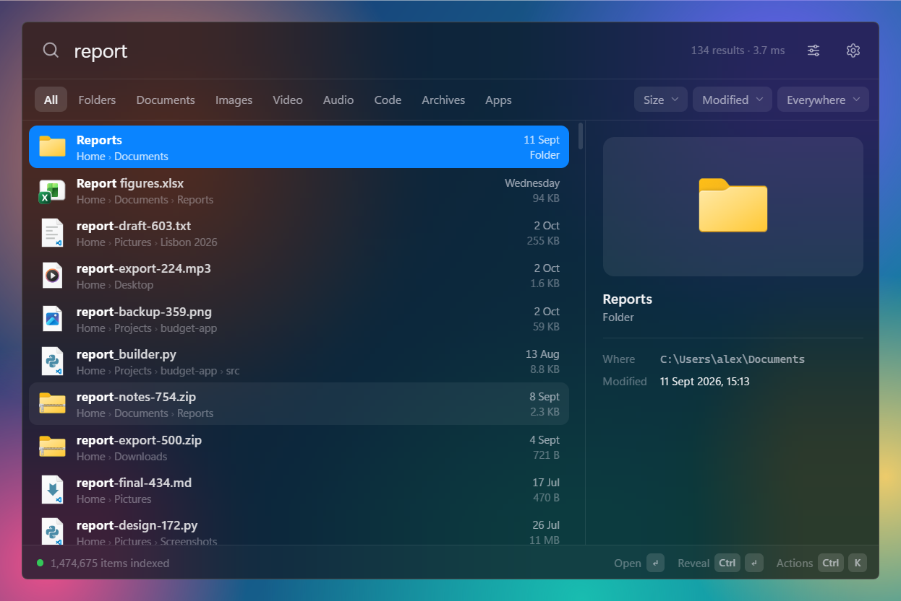

# EasySearch

Instant file and folder search for Windows, in a frosted-glass command palette.
Press **Win+Space** anywhere, type a few letters, hit Enter.



> Prototype. It works end to end and is fast, but see [Status](#status) for what is still rough.

## What it does

- **Searches everything as you type.** Every file and folder in the locations you choose is held in
  an in-memory index, so results update on each keystroke (a few milliseconds over 1.5 million items).
- **Indexes once, then only follows changes.** The drive is scanned in full a single time. After
  that the index is kept current from Windows' own change log, re-reading only the folders that
  changed — including whatever changed while the app was closed.
- **Sits quietly in the background.** It waits in the notification area using next to no CPU and
  opens in well under a tenth of a second.
- **Filters.** Type (folders, documents, images, video, audio, code, archives, apps), size, date
  modified, and "only inside this folder" — as one-click chips or typed operators.
- **Scope control.** Pick which drives and folders are indexed and which folders are left out
  (by name anywhere, like `node_modules`, or by full path). Hidden and system items are opt-in.
- **Palette workflow.** Global hotkey, keyboard-first, the same icons Explorer shows, a preview pane with
  thumbnails and text snippets, and an actions menu (open, reveal, copy path, open in Terminal…).
- **Looks the part.** A blurred, see-through window in light or dark, with a choice of accent colour.

## Run it

Requires Windows 10/11, the [.NET 10 SDK](https://dotnet.microsoft.com/download) and the WebView2
runtime (already part of Windows 11).

```bash
dotnet run --project src/EasySearch -c Release
```

The first launch indexes every fixed drive; results appear while it works. After that, EasySearch
lives in the notification area — summon it with the hotkey or by clicking its icon. Turn on
**Settings → General → Launch at login** to have it there after every restart.

To build a folder you can copy elsewhere:

```bash
dotnet publish src/EasySearch -c Release -r win-x64 --self-contained false -o publish
```

## Searching

| Type this | To find |
| --- | --- |
| `report 2026` | names containing every word, in any order |
| `jpg\|png` | either one |
| `!draft` | everything except matches |
| `"annual report"` | an exact phrase |
| `*.log`, `img_????.jpg` | wildcards (match the whole name) |
| `ext:pdf`, `ext:jpg;png` | by extension |
| `type:image` | by kind: `folder`, `file`, `image`, `video`, `audio`, `document`, `code`, `archive`, `app` |
| `size:>100mb`, `size:1mb..1gb`, `size:empty` | by size (`tiny` … `gigantic` also work) |
| `dm:today`, `dm:7d`, `dm:2026-03`, `dm:>2026-01-01` | by date modified |
| `in:C:\Projects` | only inside a folder |
| `src\ main`, `path:backup` | a backslash (or `path:`) matches against the full path |
| `regex:^IMG_\d+` | regular expressions |

Operators combine freely: `type:image dm:30d size:>2mb !screenshot`.

### Keys

Win+Space normally switches keyboard layouts; EasySearch takes it over while it runs (Alt+Shift
still switches layouts). Pick any other combination in **Settings → General** if you prefer.

| Key | Action |
| --- | --- |
| `Win+Space` | show / hide (change it in Settings) |
| `↑` `↓` `PgUp` `PgDn` | move through results |
| `Enter` | open |
| `Ctrl+Enter` | reveal in Explorer |
| `Ctrl+K` or right-click | actions menu |
| `Ctrl+C` / `Ctrl+Shift+C` | copy path / copy name |
| `Tab` / `Shift+Tab` | cycle the type filter |
| `Ctrl+,` | settings |
| `Esc` | clear the search, then the filters, then hide |

## How it works

```
src/
  EasySearch.Core/   index, scanner, query parser, search engine, change tracking   (no UI)
  EasySearch/        the Windows app: window, hotkey, tray, icons, and the bridge to the interface
    ui/              the interface itself: plain HTML, CSS and JavaScript shown in WebView2
  EasySearch.Cli/    `esearch`: index a folder and query it from a terminal (also the benchmark)
tests/               xUnit tests that run the engine against a real folder tree
```

- **Index** (`FileIndex`): parallel arrays — name, parent, size, date, flags — with all names back to
  back in one buffer. Paths are never stored; each entry points at its parent folder.
- **Scan** (`IndexBuilder`): folders are walked in parallel; one directory query per folder returns
  names, sizes, dates and attributes together, so there are no per-file system calls.
- **Search** (`SearchEngine`): a query usually contains some literal text, so one vectorised search
  runs across the whole name buffer and only the entries it lands in are evaluated against the rest
  of the query. Each thread keeps just the best hits it needs.
- **Staying current** (`IndexService`, `UsnJournal`): NTFS keeps a change journal of every create,
  delete, rename and write. Every couple of seconds (less often while the palette is hidden) the
  service asks it which folders changed since the last position it read, re-lists just those
  folders and reconciles the index. The position is saved with the cached index, so a restart
  continues from where it stopped. This needs no administrator rights. A location is only scanned
  again when there is no other way to know what changed: the journal no longer reaches back far
  enough (it holds a few hours of activity), or the drive has no journal — FAT/exFAT and network
  drives are followed with file system notifications while the app runs and re-checked at most
  once a day.
- **Hotkey** (`HotkeyHook`): combinations Windows hands out are registered normally; ones it
  reserves, such as Win+Space, are taken with a low-level keyboard hook on its own thread.
- **Window** (`MainForm`, `Backdrop`): a frameless, always-on-top window. The frosted background is
  the app's own: it captures the screen behind the palette as it opens, blurs and tones it, and
  paints it under the transparent interface. (Windows' built-in acrylic turns into a flat colour
  when "Transparency effects" is off, so it is not used.)

Measured on the development machine (12 logical cores, NVMe, 1.47 million items):

| | |
| --- | --- |
| Full scan | 9 s with a warm file cache, about 35 s cold |
| Memory | about 125 MB |
| Typical query (`readme !node`, `*.csproj`) | 4 ms |
| Filter-only query (`type:image dm:30d`) | 30 ms |
| Single letter (937,000 matches) | 100 ms |
| Hotkey to palette on screen | about 70 ms (interface ready at about 120 ms) |
| Idle in the background | about 0.05% of the machine's CPU |
| Catching up after a restart | no scan: only the folders that changed are re-read |

## Development

```bash
dotnet test                                   # engine tests
dotnet run --project src/EasySearch.Cli -c Release -- C:\Projects -q "*.csproj" -q "size:>1gb"
python -m http.server 5173 --directory src/EasySearch/ui   # the interface alone, on sample data
```

Useful switches for the app: `--stay` (don't hide when focus is lost), `--query <text>`,
`--settings`, `--demo` (sample data in the real window, for screenshots), `--passive` (never take
keyboard focus), `--background` (start hidden; used by "Launch at login"). Set `EASYSEARCH_DATA`
to a folder to keep settings and the index there instead of in `%APPDATA%` / `%LOCALAPPDATA%`, and
`EASYSEARCH_TRACE=1` to log how long each step of showing the palette takes to `trace.log` there.

`pwsh tools/make-icon.ps1` regenerates the app icon.

`publish-release.bat` runs the tests, builds a self-contained `win-x64` zip and uploads it to this
repository's GitHub Release, replacing the previous build. The first run signs in to GitHub and
creates the repository. Builds are never committed to git.

## Status

Working and verified: indexing, search and every operator above, change-journal updates (live and
across restarts), the cache, the palette window, the Win+Space hotkey, tray, single instance,
Windows icons, preview, settings.

Known gaps:

- **The one-time first scan is slower than Everything's.** Everything reads the NTFS master file
  table directly (seconds for millions of files, but it needs administrator rights or a service).
  EasySearch walks folders with normal permissions, so the first scan takes tens of seconds. It
  happens once; after that only changes are processed.
- **A long gap can still force a re-scan.** The change journal holds a limited amount of history
  (roughly four hours of activity on the development machine). If EasySearch was not running for
  longer than the journal reaches back, that drive is scanned again in the background. Running it
  at login avoids this.
- **Memory.** The app itself uses about 100 MB plus the index; the embedded browser engine that
  draws the interface adds roughly 300 MB.
- **Folders you cannot read are skipped**, for the same reason.
- **The blur is a snapshot**, taken each time the palette opens. A video playing behind it will not
  keep moving through the glass.
- Queries that only match on the path (`path:foo` with nothing else) and regular expressions scan
  every entry and take longer (roughly 70–200 ms at 1.5 million items).
- Folder sizes are not calculated; size filters apply to files.
- No installer yet, and the window cannot be resized.
